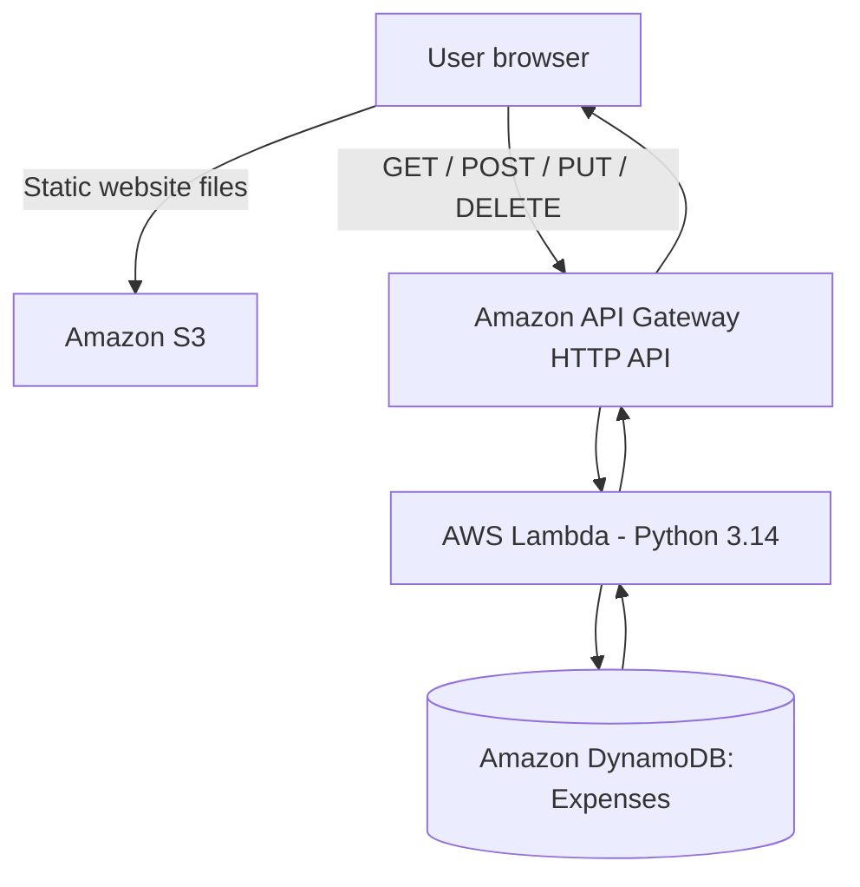

# ExpenseFlow — Cloud-Based Expense Tracker

A 7th-semester Cloud Computing project: a personal expense tracker hosted on Amazon S3, with an Amazon API Gateway HTTP API, an AWS Lambda Python backend, and Amazon DynamoDB storage.

**Live website:** http://expenseflow-website-2026-farmaan.s3-website.eu-north-1.amazonaws.com

## Features
- Add, view, edit, and delete expenses.
- Dashboard showing total spending, transaction count, and highest expense.
- Category-wise spending totals and percentage bars.
- Categories: Food, Transport, Shopping, Education, Bills, Other.
- Responsive HTML/CSS interface.

## AWS architecture



| Component | Confirmed configuration |
|---|---|
| Frontend hosting | Amazon S3 |
| S3 bucket | `expenseflow-website-2026-farmaan` |
| AWS region | `eu-north-1` |
| API Gateway | HTTP API, `expenseflowapi` |
| API ID | `qkuy0vdnh5` |
| API endpoint | `https://qkuy0vdnh5.execute-api.eu-north-1.amazonaws.com/prod/expenses` |
| Backend | AWS Lambda, Python 3.14 |
| Database | DynamoDB table `Expenses` |
| Partition key | `expenseID` (String) |
| Sort key | None |
| Capacity mode | On-demand |

## Repository structure

```text
ExpenseFlow/
├── frontend/
│   ├── index.html
│   ├── style.css
│   └── script.js
├── backend/
│   └── lambda_function.py
├── docs/
│   ├── architecture.md
│   └── deployment.md
├── .gitignore
└── README.md
```

## Run locally
1. Clone the repository: `git clone <YOUR_REPOSITORY_URL>`
2. Open `frontend/index.html` in a browser, or serve the `frontend` folder with a local static web server.
3. The frontend uses the deployed API URL in `frontend/script.js`. The API must allow the website origin through its CORS configuration.

## Deployment overview
1. Upload `frontend/` files to an S3 bucket and enable static website hosting.
2. Create DynamoDB table `Expenses` with String partition key `expenseID` and On-demand capacity.
3. Deploy `backend/lambda_function.py` as a Python 3.14 Lambda function. Its execution role needs least-privilege access to the table for `PutItem`, `Scan`, `UpdateItem`, and `DeleteItem`.
4. Configure an API Gateway HTTP API with `GET`, `POST`, `PUT`, and `DELETE` routes integrated with the Lambda function.
5. Deploy the API stage and update `API_URL` in `frontend/script.js` if the endpoint changes.
6. Configure CORS for the S3 website origin, the four methods, and the `Content-Type` header.

See [`docs/deployment.md`](docs/deployment.md) for more detail.

## Important notes
- The frontend currently has no user authentication. Do not use it for sensitive financial information.
- The Lambda GET operation uses DynamoDB `Scan`, which may need a more scalable access pattern for larger datasets.
- The S3 static website endpoint uses HTTP. Use an HTTPS-enabled distribution such as CloudFront if HTTPS is required.
- Never commit AWS credentials, secret keys, passwords, or tokens.
- Add your three group members and their contributions here.

**Course:** Cloud Computing · **Semester:** 7th · **Cloud provider:** AWS
