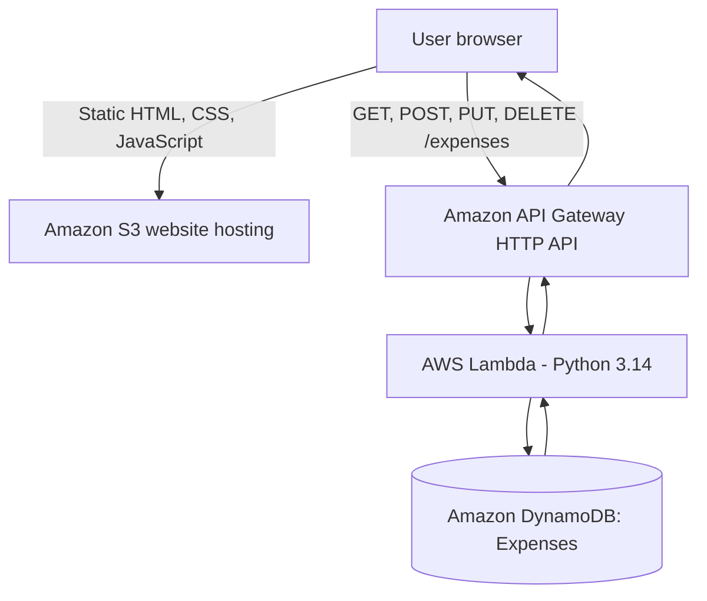

# ExpenseFlow architecture

ExpenseFlow is a serverless application deployed on AWS.

## Request flow
1. The browser downloads the frontend files from the S3 static website.
2. `frontend/script.js` sends requests to the API Gateway endpoint.
3. API Gateway routes the HTTP methods to the Lambda integration.
4. Lambda reads the method from `event.requestContext.http.method`.
5. Lambda uses Boto3 to create, scan, update, or delete items in DynamoDB.
6. The response returns through API Gateway to the browser.

## Data model
Each expense item contains `expenseID` (String partition key), `description`, `amount`, `category`, and `date`.

DynamoDB table: `Expenses`; sort key: none; capacity: On-demand; region: `eu-north-1`.
